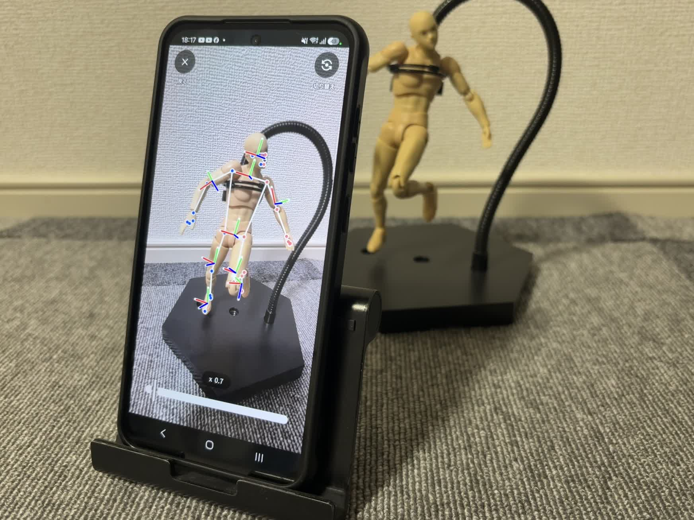

# xvr_tracker


## Description



[日本語](README.md)

An Android and iOS app that uses AI (MediaPipe Pose Landmarker) to measure and infer the user's pose through the camera, then sends Full Body Tracking data to VRChat.

## Development Environment

| Tool | Version |
|------|---------|
| Android SDK | 37 |
| Android Gradle Plugin | 9.4.1 |
| Gradle | 9.6.0 |
| OpenJDK | 21 (compile target; Gradle JDK may be 17–26) |
| Xcode | 16.2 |
| CocoaPods | 1.17.0 |

## Supported versions

OS versions required to use the app.

| Platform | Supported OS |
|----------|--------------|
| Android | Android 10 or later |
| iOS | iOS 18.2 or later |

## Build and install on a device

Build and on-device install steps assume **Android Studio** / **Xcode**.

### Android

#### Setup

1. Install [Android Studio](https://developer.android.com/studio).
2. Open the `android/` directory in this repository with Android Studio.
3. In SDK Manager, install **Android SDK 37** (`compileSdk` / `targetSdk`).
4. Set **Settings → Build Tools → Gradle → Gradle JDK** to **JDK 21** (the project’s compile target; Gradle itself can run on 17–26).
5. Finish the first Gradle Sync (`local.properties` is generated automatically and is not tracked by Git).

- `applicationId`: `com.exmachina.xvrtracker`
- `minSdk`: 29 / `targetSdk`: 37

#### Build

1. Confirm the run configuration targets the `app` module.
2. Run **Build → Make Project**.  
   To produce an APK only, use **Build → Build Bundle(s) / APK(s) → Build APK(s)**.

#### Install on a device

1. Connect an Android device over USB and enable **Developer options** and **USB debugging**.
2. Select the device from the device list in the Android Studio toolbar.
3. Use **Run → Run 'app'** (▶) to build, install, and launch.

### iOS

These steps assume a **free Apple ID (Personal Team)** so you can install a development build on your own iPhone. A paid Apple Developer Program membership is not required. Free provisioning signatures typically expire after about **7 days**, after which you need to reinstall from Xcode.

#### Setup

1. Create an [Apple ID](https://appleid.apple.com/) if you do not have one.
2. Install [Xcode](https://developer.apple.com/xcode/) on a Mac and finish the first-launch extra components install.
3. In Xcode → **Settings → Accounts**, add your Apple ID.
4. One-time setup: install CocoaPods dependencies in Terminal (build/install after this is done in Xcode).

```bash
cd ios/xvr_tracker
pod install
```

5. Open **`xvr_tracker.xcworkspace`** in Xcode (not the `.xcodeproj`).
6. Select the app target (`xvr_tracker`) → **Signing & Capabilities**:
   - Turn on **Automatically manage signing**
   - Set **Team** to your Apple ID (Personal Team)
   - If the Bundle Identifier conflicts, change it to something unique (for example `com.yourname.xvrtracker`)
7. Connect the iPhone over USB and tap **Trust** on the device.
8. On iOS 16+, enable **Settings → Privacy & Security → Developer Mode**, then restart (if the toggle is missing, try Run from Xcode once).

- Deployment target: around iOS 18.2 (match Xcode and device OS accordingly)

#### Build

1. In the Xcode toolbar, select the `xvr_tracker` scheme and your device (or a simulator).
2. Run **Product → Build** (`⌘B`).  
   If signing fails, re-check Team / Bundle Identifier above.

#### Install on a device

1. With the device selected, run **Product → Run** (`⌘R`).
2. On first launch, open **Settings → General → VPN & Device Management** on the iPhone (label may vary by iOS version) and **Trust** the developer app.
3. Launch CamTra from the Home Screen.
4. When the free provisioning signature expires, Run again from Xcode to reinstall.

## Usage

### PC settings

#### Find the VRChat PC IP address

In CamTra, set the **local IP address of the PC running VRChat** (for example `192.168.x.x`). Keep the phone and PC on the same local network (same Wi‑Fi, etc.).

**Command Prompt / PowerShell**

```bat
ipconfig
```

Note the **IPv4 Address** of the active LAN/Wi‑Fi adapter.

Example to list IPv4 addresses:

```powershell
Get-NetIPAddress -AddressFamily IPv4 | Where-Object { $_.IPAddress -notlike '127.*' }
```

Via GUI:
**Settings → Network & Internet → Properties** → IPv4 address

#### VRChat settings

1. **Launch VRChat** on the PC.
2. Open the Expression menu.
3. Set **Option → OSC → Enable** to **ON**.
4. If **Calibration** does not appear in the menu, **restart VRChat**.
5. CamTra sends to port **9000** by default (VRChat’s default receive port).

See also: [OSC Overview](https://docs.vrchat.com/docs/osc-overview)

### App settings

On first launch, the tutorial (onboarding) is shown. To run it again later: **Settings → Other → Tutorial**.

1. Launch CamTra.
2. Enter your **height** (improves pose estimation).
3. Enter the **destination IP address** of the PC running VRChat (port is usually `9000`). You can change this later under **Settings → Connection to VRChat**.
4. After **Start tracker**, grant the required permissions:
   - Camera access
   - Local network access (especially on iOS)
5. Tap **Start tracker** on the settings screen.
6. Calibrate in VRChat:
   1. Keep the tracker running
   2. Open the menu
   3. Open **Calibration**
   4. Match the T-pose avatar and align the IK points to each body part
   5. Pull both controller triggers

### PC–app connectivity test

Confirm that tracking data from the app reaches VRChat.

1. **Start the tracker** in CamTra.
2. In VRChat, open the Expression menu.
3. Select **Option → OSC → Debug**.
4. Confirm that OSC data from the app appears in the debug console.

## References

- [Pose landmark detection guide](https://developers.google.com/edge/mediapipe/solutions/vision/pose_landmarker)
  - Framework for AI-based pose estimation
- [OSC Trackers](https://docs.vrchat.com/docs/osc-trackers)
  - Specification for sending body tracking data to VRChat
- [VRChat用のフルトラをWEBカメラとMediaPipeで作ってみた](https://qiita.com/as_kuya/items/fd10b3c1156f603604b3)
  - Research on sending data to VRChat

## License

This project is licensed under the [MIT License](LICENSE).
