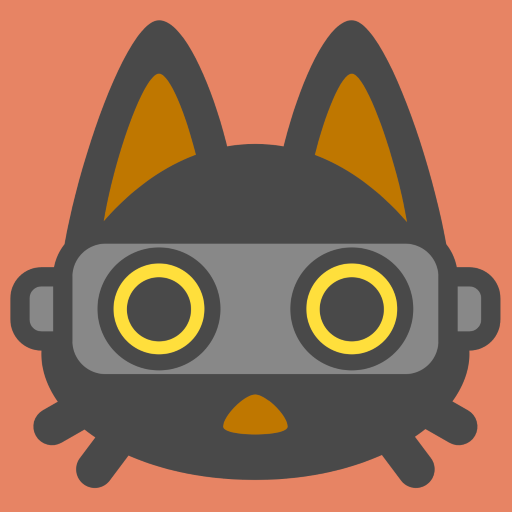
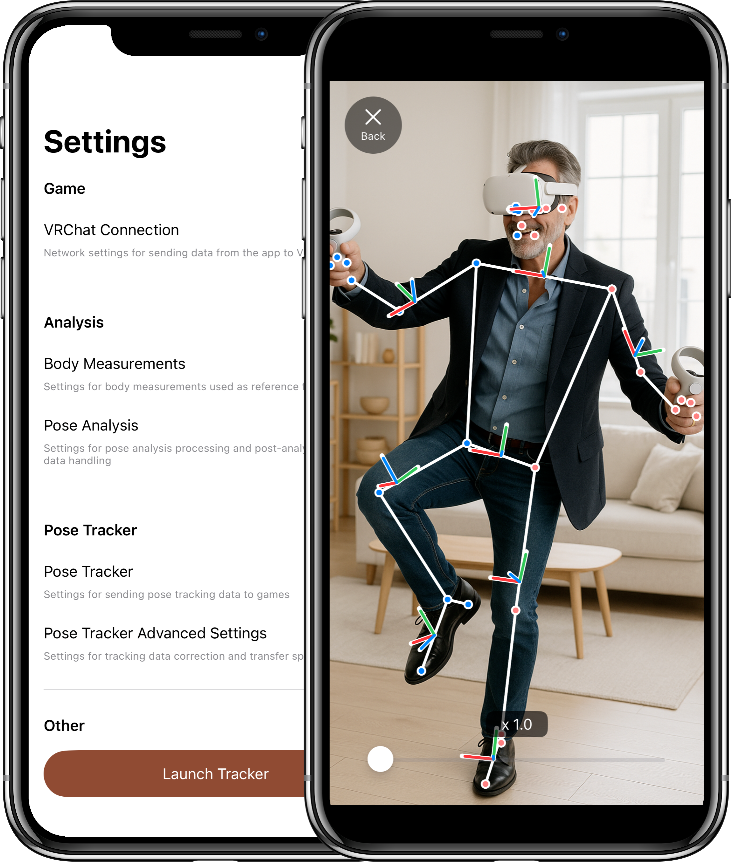
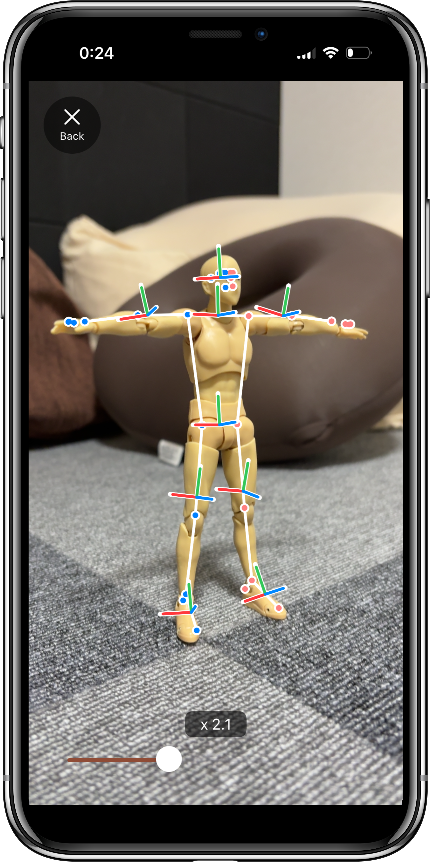

# CamTra - Camera Motion Tracking

You can track your body using only your smartphone’s camera, and the app transmits your tracking data to VRChat for full-body tracking (FBT).

This app provides body-tracking data to VR games using only your smartphone’s camera. You don’t need any expensive body trackers — you can start full-body tracking easily.

- Analyzes and predicts the user’s pose in real time using AI through the smartphone camera.
- Supports sending body-tracking data to VR games via [OSC trackers](https://docs.vrchat.com/docs/osc-trackers).
- You can fine-tune the tracking data through the app’s configuration options.

## Download

- [App Store](https://apps.apple.com/app/id6755438477)
- [Google Play](https://play.google.com/store/apps/details?id=com.exmachina.xvrtracker)

## Links

- [Privacy Policy](privacy.html)
- [Support](support.html)
- [Licenses](licenses.html)
- [Source code](https://github.com/redlily/xvr_tracker)

## Contact

Reach out with any questions or comments.

- Email: [whitemagiclily00@gmail.com](mailto:whitemagiclily00@gmail.com)
